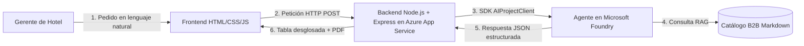
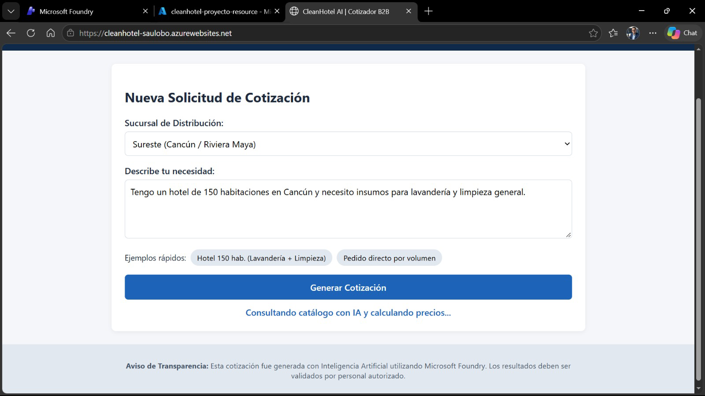
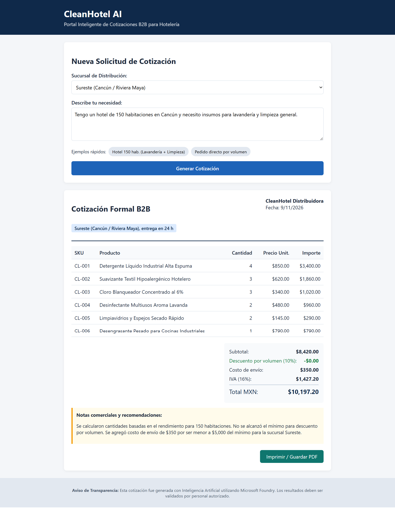
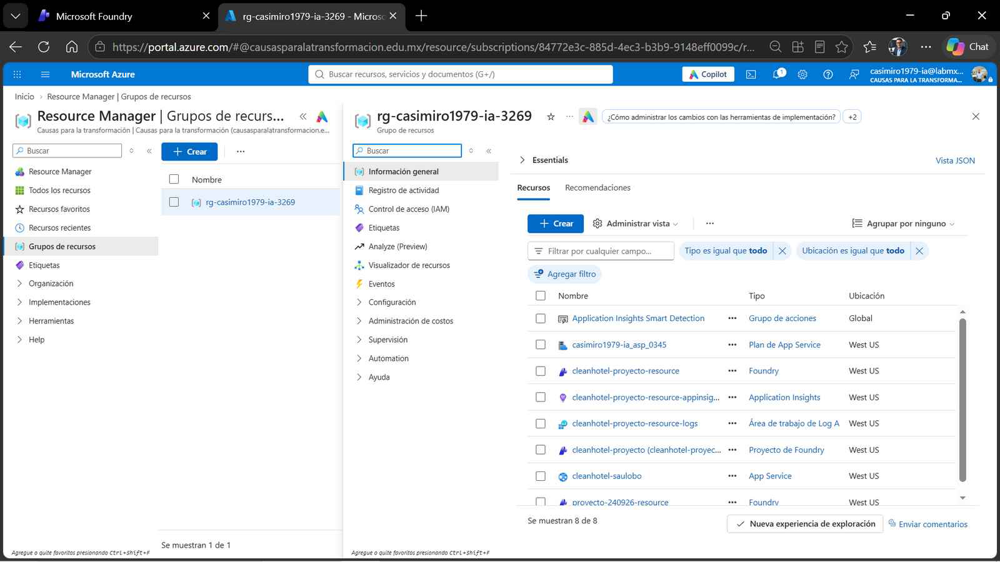

# CleanHotel AI | Cotizador Inteligente B2B

Portal web desarrollado con Inteligencia Artificial Generativa para automatizar las cotizaciones de insumos de limpieza para hoteles a partir de solicitudes en lenguaje natural.

## Enlace Público en Producción
[Abrir CleanHotel AI Cotizador B2B](https://azurewebsites.net)

## Arquitectura de la Solución

## Tecnologías Utilizadas
- **Inteligencia Artificial:** Microsoft Foundry (`gpt-4.1-mini`), RAG con catálogo B2B, salidas estructuradas en JSON.
- **Nube y Seguridad:** Azure App Service (Linux Node 24 LTS) y Azure Entra ID (Identidad Administrada).
- **Desarrollo:** Node.js, Express, HTML5, CSS3, JavaScript y GitHub Copilot.

## Evidencias de Funcionamiento

### 1. Pantalla Principal

### 2. Cotización Generada por IA

### 3. Despliegue en Azure App Service
